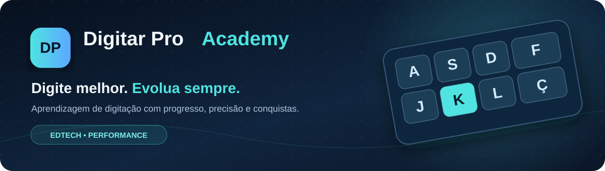

<div align="center">
  
  <br/><br/>
  <a href="https://alexsandsouza.github.io/digitar-pro/"></a>
  <a href="https://github.com/alexsandsouza/digitar-pro"></a>
  <br/><br/>
  
  
  
  
  <a href="https://hits.sh/github.com/alexsandsouza/digitar-pro/"></a>
  <p><strong>Pratique com propósito. Acompanhe sua evolução. Conquiste fluência.</strong></p>
  <p>Plataforma educacional de digitação em português, gratuita no navegador e sem cadastro nesta fase.</p>
</div>

---

## ✦ Visão geral

**Digitar Pro Academy** é o primeiro produto do ecossistema **Digitar Pro**. A experiência combina exercícios progressivos, indicadores de velocidade e precisão, feedback imediato e conquistas por módulo.

**Estado atual:** 0.6 Premium, release autorizado em 17/11/2026

> O redesign 0.6 e as correções da FEAT-001 entram pela [PR #3](https://github.com/alexsandsouza/digitar-pro/pull/3). Screenshot, teclado físico, leitor de tela, Firefox, Safari e teste de usabilidade continuam pendentes.

### ⚡ Experimente agora

**[Abrir Digitar Pro Academy](https://alexsandsouza.github.io/digitar-pro/)** · **[Ver código-fonte](https://github.com/alexsandsouza/digitar-pro)** · **[Revisar a PR #3](https://github.com/alexsandsouza/digitar-pro/pull/3)**

## ✦ Funcionalidades

| Recurso | Experiência |
|:--|:--|
| 🎯 **12 lições · 4 módulos** | Trilha prática com exercícios de complexidade progressiva |
| ⌨️ **Feedback por caractere** | Destaque do texto correto, dos erros e da próxima tecla |
| 📊 **Métricas em tempo real** | Palavras por minuto (PPM), precisão e tempo |
| 🧩 **Treinamento** | Permite terminar o exercício mesmo com erros, registrando a precisão |
| 🛡️ **Precisão** | Exige a correção de todos os erros para concluir a lição |
| ↵ **Avanço com Enter** | Após concluir, Enter inicia a próxima lição |
| 🏆 **Conquistas por módulo** | Resumo do desempenho e medalhas de progresso |
| 💾 **Progresso local** | Histórico armazenado no navegador, sem cadastro |
| ✨ **Experiência premium** | Novo design, dashboard pessoal, objetivos por lição e teclado recolhível |

## ✦ Como aprender

1. **Escolha uma lição** na trilha de aprendizagem.
2. **Selecione o modo:** Treinamento para praticar fluidez ou Precisão para aperfeiçoar a escrita.
3. **Digite o texto** e acompanhe PPM, precisão e tempo.
4. **Conclua e pressione Enter** para avançar.
5. **Finalize os módulos** e confira suas conquistas.

> **Dica pedagógica:** na fase inicial, priorize a precisão; a velocidade aumenta com prática consistente.

## ✦ Ecossistema Digitar Pro

| Produto | Proposta | Situação |
|:--|:--|:--|
| **Digitar Pro Academy** | Aprender e aperfeiçoar digitação | Em desenvolvimento contínuo |
| **Digitar Pro Kids** | Digitação lúdica para crianças | Planejado |
| **Digitar Pro Business** | Capacitação e produtividade em empresas | Planejado |
| **Digitar Pro Schools** | Gestão de turmas e professores | Planejado |

Os produtos futuros são propostas; não estão disponíveis nesta versão.

## ✦ Tecnologias e arquitetura

<div align="center">
  
  
  
  
</div>

- **Frontend estático:** HTML, CSS e JavaScript sem backend obrigatório.
- **Persistência:** `localStorage` no próprio navegador.
- **Publicação:** GitHub Pages pela branch `main`.
- **Evolução técnica:** planejamento orientado a requisitos com o framework SPECTION.

### Executar localmente

```bash
git clone https://github.com/alexsandsouza/digitar-pro.git
cd digitar-pro
```

Abra `index.html` em um navegador moderno. Para desenvolvimento, também pode usar um servidor HTTP estático local.

### Testes automatizados

Os testes de caracterização e regressão carregam o `index.html` real em jsdom, com relógio controlado e `localStorage` isolado. O jsdom é dependência **apenas de desenvolvimento**; a aplicação publicada continua sem build e sem dependências de runtime.

```bash
npm install
npm test
```

A suíte cobre modos Treinamento e Precisão, Enter, métricas, dashboard, compatibilidade do `localStorage`, resumo de módulo e acessibilidade do modal. Consulte as evidências em [docs/spection/verification/2026-11-17-test-evidence.md](docs/spection/verification/2026-11-17-test-evidence.md).

## ✦ Roadmap

| Entrega | Status |
|:--|:--|
| MVP com lições, feedback e métricas | ✅ Entregue |
| Conquistas e progressão com Enter | ✅ Entregue |
| Modos Treinamento e Precisão | ✅ Entregue |
| Redesign premium e painel do aluno | ✅ 0.6, release autorizado em 17/11/2026 |
| Testes de regressão automatizados v0.6 | ✅ 45 testes em jsdom (2026-11-17) |
| Testes de usabilidade manual v0.6 | 🧪 Pendente |
| Metas, níveis e ampliação da trilha | 📋 Planejado |
| Contas, sincronização e painel docente | 📋 Visão futura |

## ✦ Histórico de versões

| Versão | Evolução |
|:--|:--|
| **0.6 Premium (prévia)** | Layout redesenhado, dashboard local, objetivos de aprendizagem, teclado recolhível, responsividade e correções da FEAT-001 |
| **0.5** | Modos Treinamento e Precisão |
| **0.4.1** | Avanço com Enter após atingir o fim do texto no Treinamento, mesmo com erros |
| **0.4** | Identidade Digitar Pro e família de produtos |
| **0.3** | Resumo de módulo e conquistas |
| **0.2** | Avanço com Enter |
| **0.1** | Laboratório inicial com 12 lições |

## ✦ Visibilidade do projeto

O endereço público da aplicação é **https://alexsandsouza.github.io/digitar-pro/**. O badge acima utiliza o serviço externo Hits para contabilizar carregamentos do indicador no README. **Ele não equivale a visitantes únicos do site** nem substitui as estatísticas de tráfego do GitHub.

## ✦ Privacidade, limites e licença

- Os resultados ficam salvos **somente neste navegador** e não são sincronizados entre dispositivos.
- Apagar os dados do site pode remover o progresso. Não há login, cobrança nem nuvem nesta versão.
- O teclado virtual é simplificado e não representa integralmente o padrão ABNT2.
- Velocidade e precisão são indicadores educativos estimados.
- **Licença:** ainda não foi definida uma licença pública de distribuição para o código.
- **Marca:** Digitar Pro é a identidade escolhida para o projeto, sem alegação de registro de marca.

---

<div align="center">
  <strong>Digitar Pro Academy</strong><br/>
  <sub>Digite melhor. Evolua sempre.</sub><br/><br/>
  <a href="https://alexsandsouza.github.io/digitar-pro/">🚀 Acessar plataforma</a> ·
  <a href="https://github.com/alexsandsouza/digitar-pro/issues">💡 Ideias e melhorias</a>
</div>
