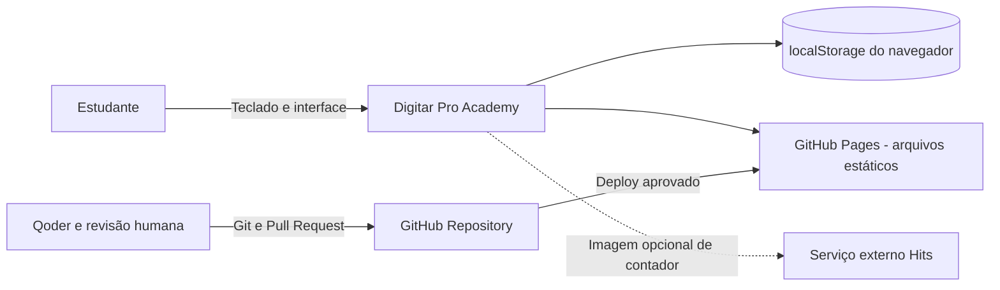

# HLD - Digitar Pro Academy

**Status:** Draft

## Objetivos

Manter a aplicação estática, com código de fácil manutenção, UX responsiva, acessibilidade, armazenamento local compatível e deploy reversível.

## Contexto

## Componentes e responsabilidades

| Componente | Responsabilidade | Interface | Dados |
|---|---|---|---|
| Curriculum | Catálogo de módulos e textos | Lista de lições | Conteúdo didático |
| Session Engine | Estado de tentativa, tempo e conclusão | Eventos de digitação | Tentativa transitória |
| Metrics | Precisão, PPM, duração | Funções determinísticas | Resultados calculados |
| Progress Store | Ler/gravar resultados e preferências | localStorage | Dados locais |
| UI | Trilha, teclado, modal, dashboard | DOM / eventos | Estado exibido |
| Release | GitHub Pages | Git/Actions | Artefatos estáticos |

## Fluxo de dados

Usuário digita → valida texto conforme modo → calcula métricas → registra progresso → atualiza interface e conquista → Enter avança. Dados de progresso não saem do navegador pelo fluxo principal. Requisições auxiliares de assets externos devem ser avaliadas separadamente.

## Infraestrutura

- Ambiente de desenvolvimento: clone do GitHub no Qoder.
- Código existente: `index.html` monolítico; refatoração possível só se preservar comportamento.
- Produção: `main` no GitHub Pages.
- Fluxo: feature branch → testes → PR → revisão → merge → checagem do site.

## Decisões e riscos

- [ADR-0001](adr/ADR-0001-brownfield.md): evolução incremental sem reescrita.
- Dados não sincronizados: limitação intencional do MVP.
- Não há integração obrigatória do Qoder com SPECTION; usar os documentos e AGENTS.md como contexto.

## Aprovação

Pendente da revisão do responsável pelo produto.
